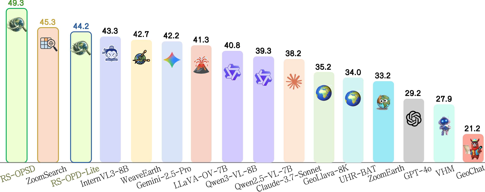
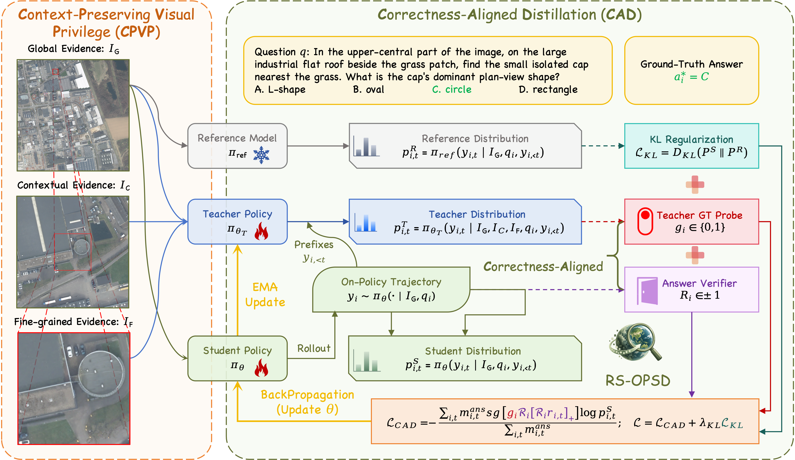
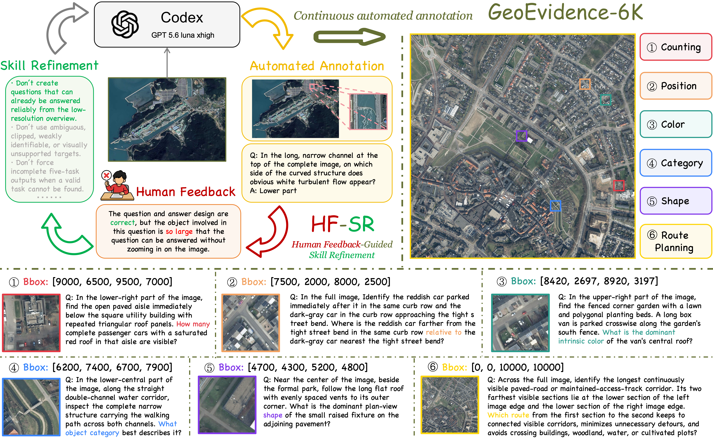
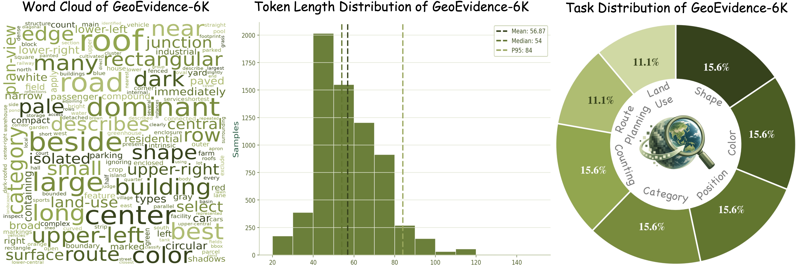

<p align="center">
  
</p>

<h1 align="center">
  
</h1>

<p align="center">
  <a href="https://huggingface.co/datasets/ronniejiangC/GeoEvidence-6K"></a>
  <a href="https://huggingface.co/ronniejiangC/RS-OPD-Lite"></a>
  <a href="https://huggingface.co/ronniejiangC/RS-OPSD"></a>
  <a href="https://arxiv.org/abs/2609.38072"></a>
</p>

## Overview

**RS-OPSD** trains remote-sensing vision-language models to internalize
question-relevant visual evidence. During inference, the model answers from
a single global image, without visual search or crop-generation tools.


### Results

<p align="center">
  
</p>

Average scores across **XLRS-Bench**, **MME-RealWorld-RS**, and **LRS-VQA**.
RS-OPSD achieves the best results on all three benchmarks among the methods
compared in the paper, improving the average score over the strongest competing
method, ZoomSearch, by **4.0 percentage points**.

| Model | Inference model size | XLRS-Bench | MME-RealWorld-RS | LRS-VQA | Average | Latency (s/sample) |
| --- | --- | --- | --- | --- | --- | --- |
| Qwen3-VL-8B-Instruct | 8B | 50.5 | 41.9 | 30.1 | 40.8 | 1.75 |
| RS-OPD-Lite | 2B | 45.8 | 56.2 | 30.5 | 44.2 | **1.09** |
| RS-OPSD | 8B | **53.1** | **61.5** | **33.3** | **49.3** | 1.58 |

### Method

<table>
  <tr>
    <td><em>Can the benefit of zoom-in evidence be internalized during training, rather than requiring visual search or tool use at inference time?</em></td>
  </tr>
</table>

<p align="center">
  
</p>

**Context-Preserving Visual Privilege (CPVP): what should the teacher see?**
The teacher receives three complementary views: **Global Evidence** preserves
scene-level context, **Contextual Evidence** retains the target and its
surroundings, and **Fine-grained Evidence** provides a tight target crop.
The student and frozen reference model receive only the global view.

**Correctness-Aligned Distillation (CAD): when should the student trust it?**
The student generates one on-policy response. Instead of generating a separate
trajectory, the privileged teacher evaluates the same student-generated prefixes.
CAD filters supervision at two levels:

- **Sample-level reliability:** a teacher-forced ground-truth-prefix probe keeps
  samples only when the teacher selects the GT continuation at every probe
  position within the valid candidate set.
- **Token-level alignment:** for a correct student answer, retain teacher
  preferences that reinforce the sampled tokens; for an incorrect answer,
  retain preferences that suppress them. Unreliable or conflicting signals are
  discarded.

### GeoEvidence-6K

<p align="center">
  
</p>

**GeoEvidence-6K** pairs UHR remote sensing questions with explicit
question-relevant evidence regions. It contains **6,750 VQA samples** derived
from **1,050 source images** across five public sources: MiniFrance, HRSCD,
SWISSIMAGE, GeoNRW, and Beeldmateriaal. Source images average
**10,714 × 10,714 pixels**, while annotated target regions average
**1,095 × 1,074 pixels**—roughly **1%** of the full-image area.

**Human Feedback-Guided Skill Refinement (HF-SR)** turns annotation feedback
into reusable rules for constructing evidence-grounded questions.

<p align="center">
  
</p>

The dataset covers counting, position, color, category, shape, land use and
route planning.

The standardized release contains **6,000 single-choice** and **750
multiple-choice** questions, together with four processed image views:
`plain`, `global`, `contextual`, and `evidence`. Original large images are not
included. Download the dataset and find its usage guide on
[Hugging Face](https://huggingface.co/datasets/ronniejiangC/GeoEvidence-6K).

## Environment Setup

### Clone the repository

```bash
git clone https://github.com/Ronniejiang/RS-OPSD.git
cd RS-OPSD
```

Run all commands below from this **repository root**. Use Python 3.12.
Local inference and training require a working CUDA GPU runtime; training
also requires NCCL. Check GPU visibility with `nvidia-smi` before installing.

### Inference and evaluation

Create a separate environment for the Quick Start and local Transformers evaluation:

```bash
python3.12 -m venv .venv-infer
source .venv-infer/bin/activate
python -m pip install --upgrade pip
python -m pip install torch==2.10.0 torchvision==0.25.0
python -m pip install -r eval/requirements-local.txt 'transformers>=4.57.3,<5'
```

Install PyTorch wheels compatible with your GPU driver. The commands above
use upstream wheels; preserve a working vendor runtime on custom accelerators.

For faster benchmark evaluation through vLLM, create its separate environment:

```bash
PYTHON_BIN=python3.12 EVAL_VENV="$PWD/.venv-eval" \
bash eval/scripts/create_vllm_env.sh
source .venv-eval/bin/activate
```

This script pins vLLM 0.18.0 and its evaluator dependencies. For evaluation
against an already-running OpenAI-compatible endpoint, only
`python -m pip install -r eval/requirements.txt` is needed.

### Training

Use a separate training environment so inference installs do not replace its runtime:

```bash
python3.12 -m venv .venv-train
source .venv-train/bin/activate
python -m pip install --upgrade pip
python -m pip install --use-pep517 -r rs-opsd/requirements.txt
python -m pip install --no-deps -e rs-opsd
python -m pip install -r eval/requirements.txt
python rs-opsd/scripts/preflight_runtime.py --require-devices 8
```

Replace `8` with the number of GPUs visible to the job. The training runtime
pins PyTorch 2.10.0, torchvision 0.25.0, vLLM 0.18.0, and Transformers
`>=4.57.3,<5`. `requirements-core.txt` contains application dependencies;
`requirements-runtime.txt` contains the accelerator/runtime stack. On a
prebuilt accelerator environment, install core dependencies separately and
check compatibility before changing the runtime.

## Quick Start

### Download released weights

| Model | Size | Download |
| --- | --- | --- |
| RS-OPD-Lite | 2B | [Hugging Face](https://huggingface.co/ronniejiangC/RS-OPD-Lite) |
| RS-OPSD | 8B | [Hugging Face](https://huggingface.co/ronniejiangC/RS-OPSD) |

Activate the inference environment and download the smaller model first:

```bash
source .venv-infer/bin/activate
hf download ronniejiangC/RS-OPD-Lite --local-dir models/RS-OPD-Lite
# Alternatively, download the 8B model:
hf download ronniejiangC/RS-OPSD --local-dir models/RS-OPSD
```

### Ask a question about an image

Use your own remote-sensing image; no benchmark download is required:

```bash
python -m eval.infer \
  --model-path models/RS-OPD-Lite \
  --image /path/to/aerial-image.jpg \
  --question 'What land-use types are visible in this image?' \
  --max-tokens 256
```

The answer is printed to the terminal. For multiple-choice VQA, include the
options and requested answer format in `--question`. Use
`--model-path models/RS-OPSD` for the 8B model. Thinking is disabled by default;
`--enable-thinking` enables it. Images are bounded to 16,777,216 pixels by
default; change `--max-pixels` for your hardware.

## Training

### Download the base model and GeoEvidence-6K

Activate the training environment. Training starts from a Qwen3-VL base
checkpoint, rather than the released RS-OPSD inference weights:

```bash
source .venv-train/bin/activate
hf download Qwen/Qwen3-VL-8B-Instruct --local-dir models/Qwen3-VL-8B-Instruct
hf download ronniejiangC/GeoEvidence-6K --repo-type dataset \
  --local-dir data/GeoEvidence-6K
```

The [dataset release](https://huggingface.co/datasets/ronniejiangC/GeoEvidence-6K)
contains `train/metadata.jsonl` and independent ZIP shards. Extract each ZIP
at the dataset root; its entries already contain the `train/<view>/` prefix:

```bash
python - <<'PYCODE'
from pathlib import Path
from zipfile import ZipFile

root = Path("data/GeoEvidence-6K")
for archive in sorted((root / "archives").glob("*.zip")):
    print("Extracting", archive.name)
    with ZipFile(archive) as z:
        z.extractall(root)
PYCODE

python rs-opsd/scripts/prepare_geoevidence_release.py \
  --release-root data/GeoEvidence-6K \
  --output-root data/GeoEvidence-6K-training
```

Allow approximately **80 GiB** for archives plus extracted images. All four
views are required. The conversion validates every metadata row and referenced
image, preserves sample order, and generates this training layout:

```text
GeoEvidence-6K-training/
├── final_annotations.json
├── train.jsonl
├── images/                   # plain view links
├── bbox_images/              # boxed global view links
├── teacher_images/           # evidence view links
└── derived/
    ├── train.jsonl
    └── teacher_images/       # contextual view links
```

The output must be new or empty and outside the downloaded dataset directory.
Images are linked without copying or re-encoding; keep the extracted dataset
in place. Questions preserve options and answer instructions, including
multiple-choice answers. No new image crops are generated.

If you already have the original training layout, its manifests can be rebuilt
with `rebuild_geoevidence_train_jsonl.py` followed by
`rebuild_geoevidence_derived_train_jsonl.py`, both accepting `--data-root`.
For the linked layout above, also pass `--allow-external-image-links`.

### Train RS-OPSD (8B)

Run from the repository root with the training environment activated:

```bash
MODEL_PATH="$PWD/models/Qwen3-VL-8B-Instruct" \
DATA_ROOT="$PWD/data/GeoEvidence-6K-training" \
OUTPUT_DIR="$PWD/outputs/rs-opsd" \
TRAIN_RECIPE=direct-2k-three-image-kl \
PA_OPD_GPUS_PER_NODE=8 PA_OPD_NNODES=1 \
PA_OPD_STUDENT_IMAGE_MODE=bbox_images \
PA_OPD_TEACHER_FULL_IMAGE_MODE=bbox_images \
bash rs-opsd/scripts/train_geoevidence.sh \
  data.train_batch_size=96 \
  actor_rollout_ref.actor.ppo_mini_batch_size=96 \
  actor_rollout_ref.actor.grad_clip=5 \
  actor_rollout_ref.actor.kl_loss_coef=0.001 \
  trainer.total_epochs=3 \
  trainer.total_training_steps=150
```

The student sees the boxed global view. The EMA teacher receives global,
contextual, and fine-grained evidence, in that order. The recipe uses one
rollout per sample, global batch size 96, CAD with global token-mean reduction,
and KL regularization toward a frozen reference.

Adjust GPU count and memory settings for your hardware.
`PA_OPD_MEMORY_PROFILE=low` and `PA_OPD_ROLLOUT_TP=2` are available;
the TP size must divide GPUs per node. These options do not guarantee that
the model will fit on every GPU.

### Train RS-OPD-Lite (2B)

Download its student base checkpoint:

```bash
hf download Qwen/Qwen3-VL-2B-Instruct --local-dir models/Qwen3-VL-2B-Instruct
```

Use the 8B command above with `MODEL_PATH="$PWD/models/Qwen3-VL-2B-Instruct"`,
`OUTPUT_DIR="$PWD/outputs/rs-opd-lite"`, and `trainer.total_training_steps=120`.
Append these overrides to use a frozen 8B teacher:

```text
actor_rollout_ref.actor.self_distillation.teacher_model_path=/absolute/path/to/models/Qwen3-VL-8B-Instruct
actor_rollout_ref.actor.self_distillation.fixed_teacher_ema=false
```

### Resume and export

Checkpoints, rollouts, and offline W&B logs are saved under `OUTPUT_DIR`.
Rerun the same training command with
`RESUME_FROM_PATH=/path/to/checkpoints/global_step_N` set in the environment.
Resume needs the complete checkpoint, including optimizer and teacher state;
keep topology and configuration consistent.

Export a training checkpoint to Hugging Face format for inference:

```bash
VERL_ROOT="$PWD/rs-opsd" PYTHON="$(command -v python)" \
bash eval/scripts/merge_fsdp_checkpoint_to_hf.sh \
  /path/to/checkpoints/global_step_N \
  /path/to/exported-model
```

Use the exported directory as `--model-path` in Quick Start or `MODEL_PATH`
in the evaluation scripts.

## Evaluation

### Prepare the benchmarks

Download the original benchmark data from the linked projects:

| Benchmark | Download instructions | Expected local files |
| --- | --- | --- |
| XLRS-Bench | [Project repository](https://github.com/AI9Stars/XLRS-Bench) | A `datasets.load_from_disk` directory with the benchmark's `train` split |
| MME-RealWorld-RS | [Project page](https://mme-realworld.github.io/) | `MME_RealWorld.json` and its referenced images |
| LRS-VQA | [Project repository](https://github.com/VisionXLab/LRS-VQA) | `LRS_VQA_merged.jsonl` and its referenced image paths or `image/` directory |

Validate paths before loading a model:

```bash
python -m eval.run --dataset all \
  --lrs-root /path/to/LRS-VQA \
  --mme-root /path/to/MME-RealWorld \
  --xlrs-root /path/to/XLRS-Bench \
  --dry-run
```

Inspect eligible counts and missing-image counts: missing files are skipped,
so a dry run alone does not establish that the benchmarks are complete.

### Run local vLLM evaluation

Activate the vLLM environment. This script starts a local server, verifies
model readiness, evaluates the benchmarks, and stops the server afterward:

```bash
source .venv-eval/bin/activate
MODEL_PATH="$PWD/models/RS-OPSD" \
SERVED_MODEL_NAME=rs-opsd BENCHMARK=all \
LRS_ROOT=/path/to/LRS-VQA \
MME_ROOT=/path/to/MME-RealWorld \
XLRS_ROOT=/path/to/XLRS-Bench \
TP_SIZE=1 MAX_MODEL_LEN=32768 \
RUN_NAME=rs-opsd-eval \
bash eval/scripts/run_local_vllm.sh
```

Set `TP_SIZE` for available GPUs. For a smoke test, select one benchmark
(e.g. `BENCHMARK=lrs-vqa`) and add `LIMIT=2 PARALLEL_WORKERS=1`.
Results are written to `eval/results/rs-opsd-eval/` as per-benchmark JSONL
files and `summary.json`. Check coverage and errors alongside accuracy.
`RESUME=1` skips successful samples and retries failed samples; summaries
count the latest result per sample. Use a new `RUN_NAME` for a fresh run.

### Other inference backends

For local Transformers evaluation, activate `.venv-infer` and use the same
model/dataset variables with `bash eval/scripts/run_local_transformers.sh`.
It runs one worker and does not start a server.

For an existing OpenAI-compatible endpoint:

```bash
python -m eval.run --dataset lrs-vqa \
  --lrs-root /path/to/LRS-VQA \
  --api-base http://127.0.0.1:8000/v1 \
  --model-id rs-opsd \
  --enable-thinking False \
  --run-name rs-opsd-api-eval
```

LRS-VQA uses normalized exact matching by default. Optional tolerant scoring
with a local BGE model is available via `--lrs-semantic-model` or
`LRS_SEMANTIC_MODEL` in the launch scripts; install `eval/requirements-local.txt`
for that option. Consult `python -m eval.run --help` and `eval/.env.example`
for image limits and further settings.

## License

RS-OPSD is distributed under the [Apache-2.0 license](rs-opsd/LICENSE).

## Acknowledgements

We thank the teams behind the following works for their contributions and open resources:

- **XLRS-Bench** — [Paper](https://arxiv.org/abs/2503.23771) · [Code and dataset](https://github.com/AI9Stars/XLRS-Bench)
- **MME-RealWorld** — [Paper](https://arxiv.org/abs/2408.13257) · [Project page](https://mme-realworld.github.io/)
- **LRS-VQA** — [Paper](https://arxiv.org/abs/2503.07588) · [Code and dataset](https://github.com/VisionXLab/LRS-VQA)
- **Vision-OPD** — [Paper](https://arxiv.org/abs/2605.18740) · [Code](https://github.com/VisionOPD/Vision-OPD)

## Citation

If you find this work useful, please cite:

```bibtex
@misc{jiang2026rsopsdreliableprivilegedonpolicyselfdistillation,
      title={RS-OPSD: Reliable Privileged On-Policy-Self-Distillation for Ultra-High-Resolution Remote Sensing VQA},
      author={Chengjie Jiang and Yunqi Zhou and Jiafeng Yan and Sihang Zhao and Chun Yuan and Jing Li},
      year={2026},
      eprint={2609.38072},
      archivePrefix={arXiv},
      primaryClass={cs.CV},
      url={https://arxiv.org/abs/2609.38072},
}
```
